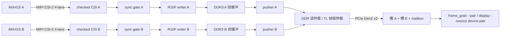

# PH1P100 PCIe EP —— 双路相机采集

> 当前事实：**2026-10-28**。A/B 两路均为 1080p R10F，自由采集各约 30 fps；硬件同步已上板锁定。
> 主机现在用 **两片 pusher + 两个 host 槽 + 一次 `ARM_PAIR/ACK_PAIR`** 同时取同一曝光对：
> `frame_grab --pair`，一次拿 A/B 两帧；实时 display 用 `--source device-pair`，同一页看 A/B。以本文和
> [docs/DATAFLOW.md](docs/DATAFLOW.md) 为准，旧日志/旧文档只作历史。

安路 PH1P100SBG484 做 PCIe Gen2 x2 端点，把两路 IMX415 的 MIPI CSI-2 整帧写进 RK3588
内存；RK3588 侧驱动提供字符节点，用户态取帧、显示/推流。

## 子仓库

| 目录 | 仓库 | 职责 |
|---|---|---|
| `fpga/` | `ph1p100-pcie-ep-fpga` | MIPI CSI-2 接收、R10F 写者、DDR3、双路 one-shot 推帧、BAR0/RKA1 |
| `driver/` | `ph1p100-pcie-ep-driver` | RK3588 Linux 驱动、一致性收帧缓冲、ioctl 与 Rust 工具 |
| `display/` | `ph1p100-pcie-ep-display` | MJPEG/快照 HTTP、R10F 解析、Bayer/后处理 |

## 当前数据通路



- 帧格式：1920×1080 packed RAW10，stride 2400 B，payload 2,592,000 B；
  R10F 128 B 头 + payload + 640 B 尾 = **2,592,768 B/帧**。
- 推帧：一次 ARM 只授权一帧，20256 笔 128 B MWr + 1 笔门铃；推完 HELD，ACK 才释放。
- 双路：A/B 各一片 pusher，两片共享 DDR 读口和 TL 用户发送口（帧级仲裁，不交错）；
  `ARM_PAIR` 同时授权两片，`ACK_PAIR` 同时释放。
- 取流：槽 0 = A、槽 1 = B；B 门铃在 mailbox +36。驱动默认 `frame_slots=2`。

## 2026-10-28 实测

| 项 | 结果 |
|---|---|
| 双路自由采集 | A/B 各 **29.993 fps**（30 s 计数，丢组 0） |
| 主机双路 pair | 纯取帧 **30.0 pair/s**（60 帧/s，PCIe ~155 MB/s）；600/600 次成功；A/B `capture_seq` 全相同 |
| 实时 display 1080p | **11 pair/s**（每对 ~90 ms，VEPU121 硬编码） |
| 实时 display 540p | **23 pair/s**（每对 ~43 ms） |
| 链路 | Gen2 x2，BAR0 1 MB |
| 硬件同步 | A 主/B 从，XHS/XVS 共享；`0x1E4=0x8000D`，warmup=8，locked=1 |
| 同步 skew | `0x1E8` 稳定 2~3 tick（62.5 MHz，约 32~48 ns），miss=0 |
| 同步启动 | 首次 9 对锁定；abort 后重新 start 可再锁 |

同步的板测记录与图像：[log/board-20261028/sync_20261028/RESULTS.md](log/board-20261028/sync_20261028/RESULTS.md)。

## 硬件同步（已上板）

- A：`XMASTER=0`、`XMSTA=1→0`、`XVS/XHS_DRV=0`（输出）；
- B：`XMASTER=1`、`XMSTA=0`、`XVS/XHS_DRV=0x0F`（Hi-Z 从机）；
- FPGA 不发同步脉冲，只做角色配置、SOF 配对和帧边界门控；
- BAR：`0x1E0 SYNC_CMD`（W1：1=START，2=ABORT），`0x1E4..0x20C` 状态；
- 主机：`link_ctl sync status|start|abort`。

详细寄存器、判据和双路实现见 [docs/SYNC_DUAL_20261028.md](docs/SYNC_DUAL_20261028.md)。
RKNN 检测的模型契约、线程与板测见 [docs/RKNN_YOLO11_20261028.md](docs/RKNN_YOLO11_20261028.md)。

## 快速开始（板子）

```sh
# 1) 下载 SRAM 位流（本地 TD；板卡随后必须重启才能重新枚举 Gen2 x2）
cd fpga
/opt/anlogic/TD_Release_2026.2_NL/bin/bw.sh download_sram.tcl
ssh root@<BOARD> 'sync; reboot'

# 2) 驱动（默认 1920x1080 / 两槽）
ssh root@<BOARD> 'insmod /root/anlogic_pci.ko frame_width=1920 frame_height=1080 frame_slots=2'
ssh root@<BOARD> 'ls /dev/ANLOGIC-PCI0_{user,control,frame}'

# 3) 启动硬件同步；等到 locked=1
ssh root@<BOARD> '/root/link_ctl sync start -t 5000'

# 4) 双路同步取一帧（离线 PGM）
ssh root@<BOARD> '/root/frame_grab --pair -t 3000 -o /dev/shm/a.pgm /dev/shm/b.pgm'

# 5) 双路实时页（A/B 并排）
ssh root@<BOARD> '/root/display-pair --source device-pair --fps 30 --port 8091'
# 浏览器打开 http://<BOARD>:8091/pair

# 6) 双路 + RKNN YOLO11n 检测/叠加（需要 /root/models/yolo11n-640-int8.rknn）
ssh root@<BOARD> '/root/display-detect --source device-pair --fps 30 --scale 2 \
  --detect --rknn /root/models/yolo11n-640-int8.rknn --port 8091'
```

> `frame_grab --pair` 自己写 B 路目标/门铃并做 `ARM_PAIR/ACK_PAIR`；不需要再调
> `link_ctl arm`。单路 A 仍用 `frame_grab -t 3000 -o a.pgm`。

## 已知边界

- 当前没有把 `sync_pairs` 打进 R10F 头；严格“同对”靠硬件同步门控 + 同一次 ARM。
- 实时 display 已接 `device-pair`：`/pair` 并排看 A/B，`/snapshot_a.jpg`、`/snapshot_b.jpg`、`/stats`。
- R10F 的 `sof_timestamp/timestamp_hz` 仍为 0；同步证据先看 BAR `0x1E8/0x1EC`。
- `0x1E8` 是 SOF/包层数字配对差，**不是曝光相位差**；不能拿它闭环曝光。
- 主从共享 XHS/XVS 的模组内部连接仍需示波器/实物连续性确认。
- 位流是 SRAM 配置：重下/掉电后必须重启 RK3588。
- 根 `log/` 是本地证据，默认被 gitignore；git clean 前先归档。

## 硬件与工具链

- FPGA：PH1P100SBG484，TD `Release_2026.2_NL`（Linux 无头：`td.sh build.tcl`）
- 主机：Orange Pi 5 Max / RK3588，内核 `7.2.0-dirty`（aarch64，NFS root）
- 相机：FEP-VID006-MIPI 子卡（IMX415 ×2，CAM005 模组）
