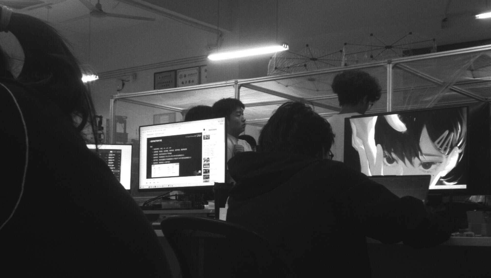

# 硬件 JPEG 压缩（交付项 3）

比赛要求硬件 JPEG 压缩、压缩率 ≥30%。当前路线是**灰度基线 JPEG**：
FPGA 只输出熵编码码流，主机补标准 JFIF 头。1920×1088 灰度、q=50 亮度表，
板上实测压缩率 **95.9%~96.3%**，压缩吞吐约 **4.5 帧/s**。

## 1. 选型与结论

白天实拍 1920×1088 灰度帧（2,088,960 B/帧）上，无损方案均未达到 30%：

| 方案 | 压缩率 | 判定 |
|---|---:|---|
| 差分 + 零游程 RLE | -8.45% | 膨胀，否决 |
| 差分 + RLE（bit7 格式） | -0.23% | 无收益，否决 |
| 差分 + LZ77 | 3.54% | 远低于 30% |
| 3×3 高斯 + 差分 LZ77 | 17.26% | 仍低于 30% |

RLE/LZ77 在白天画面上匹配开销大于冗余；暗场 31.1%/41.7% 是接近全黑的特例，不能作为交付依据。
DCT 量化直接丢弃人眼不敏感的高频，压缩率由量化表控制，因此改为 JPEG 基线。
本路线只需单分量灰度，不需要色度采样、色彩转换和重启间隔。

## 2. 码流契约

- 输入：1920×1088、8 bit 灰度，行优先。
- 分块：8×8；像素先减 128（level shift），DCT 用 Q12 定点、行列分离。
- 量化：标准亮度表，质量因子 q=50；$z = \operatorname{sign}(c)\cdot((|c|\cdot R + 2^{15}) \gg 16)$，$R = \operatorname{round}(2^{16}/q)$。
- 之字形：自然序转之字形序，输出 64 个量化系数。
- DC：与上一块 DC 差分，类别 + 幅度；**每帧首块把预测器清 0**。
- AC：`(run<<4)|category`；`ZRL` 表示 16 个零，`EOB` 结束块；负数幅度按 T.81 用 `v-1`。
- 熵编码：T.81 附录 K 亮度 DC/AC 规范哈夫曼表；字节 `0xFF` 后补 `0x00`。
- 输出：**只有熵编码字节**，不含 SOI/APP0/DQT/SOF0/DHT/SOS/EOI。
- 封装：主机 `tools/jpeg_file.py` 用常量头 + 熵流 + EOI 包成标准 JFIF；
  FPGA 把熵流写到 `0x0500_0000`，补零到固定 2,613,248 B，真实长度放 `0x250`。

## 3. RTL 模块

| 模块 | 职责 |
|---|---|
| `cstream_reader` | DDR 回读 1920×1088 灰度帧；packed RAW10 5→4 拆包，输出 8 bit 像素流 |
| `line2block` | 8 行缓冲，行扫描转 8×8 块 |
| `dct1d8` | 8 点 1D DCT，Q12 定点系数，8 拍出 8 个系数 |
| `dct2d8` | 行 DCT → 转置 → 列 DCT，复用两个 `dct1d8` |
| `jpeg_quant_zz` | q=50 亮度表量化 + 之字形扫描 |
| `jpeg_huff_tab` | T.81 附录 K 亮度 DC/AC 规范哈夫曼码表 |
| `jpeg_huff_enc` | DC 差分、AC 游程、哈夫曼打包；帧首复位 DC 预测 |
| `jpeg_enc` | 单块 DCT→量化→熵编码三级流水 |
| `jpeg_frame` | `line2block` + `jpeg_enc` 的整帧顶层 |
| `cstream_writer` | 定长 2,613,248 B 帧写 DDR，记录每帧熵流长度 |

主链：

~~~text
cstream_reader → line2block → dct2d8 → jpeg_quant_zz → jpeg_huff_enc → cstream_writer
~~~

## 4. 寄存器与主机流程

| 偏移 | 含义 |
|---|---|
| `0x240` | ALGO_CTRL：bit4=压缩使能，bit6=推压缩块，bits[2:1] 算法选路 |
| `0x250` | 最近完成压缩帧的熵流字节数（每帧刷新） |
| `0x254` | 累计回读像素（诊断） |
| `0x258` | `{jb_done[31:16], jb_v[15:0]}` |
| `0x260` | 回读启动次数 |
| `0x264` | `{reader state, writer state, busy}` |
| `0x268` | DDR 读口握手 |
| `0x26C` | 压缩帧序号 |

DDR 读口与推帧分时，主机流程两段式：

1. `0x240=0x10` 开压缩，轮询 `0x258[31:16]`（`jb_done`）等一帧完成；
2. `0x240=0x40` 关压缩并把推帧源切到压缩块，`link_ctl arm` 推一帧；
3. 从槽 0 的 `+128` 处读 `0x250` 字节。

`0x250` 旧实现是跨帧累计，已改为每帧 `fbytes`，只表示最近一帧。

## 5. 工具与验证

| 工具 | 用途 |
|---|---|
| `tools/jpeg_ref.py` | 主机黄金编码器；与 Pillow 交叉验证 |
| `tools/jpeg_block_ref.py` | 单块 DCT/量化/熵编码 oracle |
| `tools/jpeg_file.py` | 熵流包 JFIF、检查头与 PSNR |
| `tools/board/jpeg_cap.py` | 板端两段式压缩、推帧、取流 |
| `tools/board/jpeg_pair_test.sh` | 取前后参考帧，做同场景 PSNR |

- `jpeg_ref.py` 与 Pillow 在多个质量因子下码流大小/PSNR 偏差 ≤1.5%。
- 单块 oracle 用于 DCT、量化、熵编码逐级对拍。
- PIL 解码主机封装后的 JPEG 无告警。
- DC 预测复位修复后，两帧仿真输出逐字节一致。

## 6. 实测结果

| 项 | 结果 |
|---|---:|
| 成对静态场景（最终位流） | 83,245 B |
| 静态压缩率 / 倍数 | 96.02% / 25.1× |
| 连续三次采集 | 85,901 / 85,796 / 76,727 B（95.89%~96.33%） |
| 码流长度范围 | 30~110 KB（随场景） |
| 吞吐 | ~4.5 帧/s（`jb_done` 2.0 s 内 3→12） |
| 静态区域 PSNR | 34~40 dB |
| 同场景参考帧整帧 PSNR | 33.9 dB |

原始帧 2,088,960 B。码流长度随内容变化，故用固定长度帧 + `0x250` 截取。

板端压缩、经 PCIe 回传后由 `tools/jpeg_file.py` 解码的实拍图（1920×1088，83,245 B）：

## 7. 已知边界

- 压缩支路约 4.5 帧/s，不是实时；只支持 1920×1088 灰度。
- 读口静默窗 + 源块保护：`c2_en` 打开时先等 DDR 读口 8191 拍无 AR/R 活动再启动；
  回读期间相机写者不覆盖源块，读完由 `o_done` 释放。连续 3/3 采集通过。
- 熵流在定长帧里补零到 2,613,248 B，主机必须按 `0x250` 截取，不能把补零当码流。
- 位流是 SRAM 配置，重下/掉电后需重启 RK3588 重新枚举。
