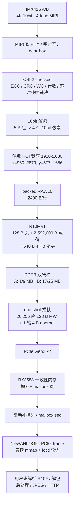
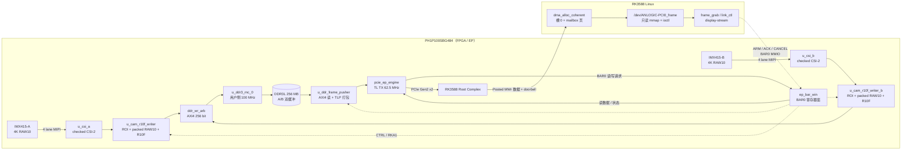
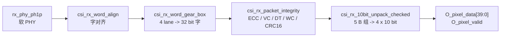
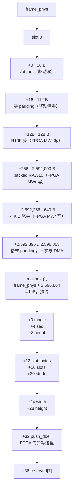
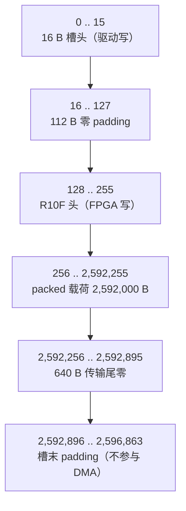
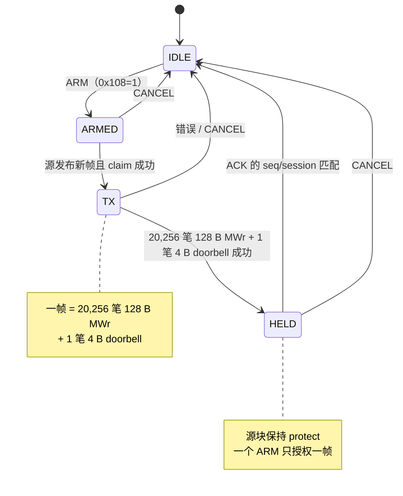

# PH1P100 PCIe EP 全项目数据链路（当前工作树）

> 本文以当前 checkout 的真实代码为准，不以根 README 的历史结论为准。
>
> - FPGA：<code>fpga</code> HEAD <code>9fd87d63</code>；工作树另有未提交修改：<code>rtl/ep_side/cam/ui_imx415_reg.v</code>（27 MHz / 4K 表）和 <code>rtl/ep_side/ddr/cam_r10f_writer.v</code>（通用停滞看门狗）。
> - 驱动：<code>driver</code> HEAD <code>506e73d</code>；C 源未改，<code>app/rs/src/bin/frame_grab.rs</code> 等工作树有改动。
> - 显示：<code>display</code> HEAD <code>fca46e3</code>。
> - 根 README 仍有“12.5 MHz / 7.85 fps / A 路写者从不发布”等旧结论；当前代码已是 27 MHz、双路 30 fps、A/B 都能发布。冲突时以本文和代码为准，见 §9。
>
> 本文只描述代码里真实存在并接通的路径。死代码、未例化模块、调试旁路、文档漂移，以及“主机侧并没有真的接上”的环节，全部单独列出。

---

## 0. 一页结论

完整链路：

必须记住的数字：

| 量 | 值 |
|---|---:|
| 源图 | 3840x2160 RAW10，双路 |
| ROI | 1920x1080，x=960，有效图 y=540，物理行偏移 37 |
| packed 行宽 | 2400 B |
| packed 载荷 | 2,592,000 B |
| R10F 内容（头+载荷） | 2,592,128 B |
| 一次 DMA 总长 | 2,592,768 B |
| 4KiB 尾零 | 640 B |
| 每帧 MWr | 20,256 笔（每笔 128 B 载荷） |
| 门铃 | 1 笔 4 B MWr |
| 主机槽数据起点 | 槽基址 + 128 B |
| 主机槽步长 | 2,596,864 B |
| 单槽总分配 | 2,600,960 B |

最关键的语义：这是 **one-shot** 通路，不是自由流。一次 ARM 只授权一帧；FPGA 推完进 HELD，必须主机 ACK 才释放源缓冲并允许下一次 ARM。传感器可以一直 30 fps 往 DDR3 写，但主机不 ARM/ACK 就只能拿到 probe 那一次 ARM 的帧。

---

## 1. 物理/逻辑拓扑

- 本板只使用 EP 侧顶层 <code>fpga/rtl/ep_side/ph1p_pcie_ep_top.v</code>。<code>fpga/rtl/rc_side/</code> 是另一块 RC 参考板的例程，不在本数据链路里。
- 只有 **一个** 推帧引擎、**一个** DDR 读口、**一个** 主机目标地址。A/B 可以同时采集、同时写 DDR3，但同一时刻只能推一路。
- 只有 **一个** 收帧节点 <code>/dev/ANLOGIC-PCI0_frame</code>。没有 <code>_frame_b</code> 节点；看 B 路靠 <code>CTRL[8]=1</code> 选源。

---

## 2. 代码入口与职责

| 层 | 文件 | 职责 |
|---|---|---|
| 顶层 | <code>fpga/rtl/ep_side/ph1p_pcie_ep_top.v</code> | 时钟/复位、两片 CSI、两片 R10F 写者、DDR3、写仲裁、推帧、BAR 接线 |
| PCIe 引擎 | <code>fpga/rtl/ep_side/pcie_ep_engine.v</code> | TL RX/TX、CPL、BAR 窗口、用户侧 TL 发送口仲裁 |
| BAR 窗口 | <code>fpga/rtl/ep_side/img/ep_bar_win.v</code> | 0x40~0x1DC 寄存器、主机预取、RKA1 寄存器面 |
| MIPI/CSI | <code>fpga/rtl/ep_side/cam/mipi_csi2_rx_ph1p_checked.v</code> | 软 PHY、字对齐、gear box、checked 包层、解包 |
| 包完整性 | <code>fpga/rtl/checked/csi_rx_packet_integrity.v</code> | 头 ECC、VC/DT、WC、CRC16、行数、超时、FS/FE 裁决 |
| 解包 | <code>fpga/rtl/checked/csi_rx_10bit_unpack_checked.v</code> | 5 字节组 -> 4 个 10bit 像素（40 bit） |
| R10F 写者 | <code>fpga/rtl/ep_side/ddr/cam_r10f_writer.v</code> | ROI、packed RAW10、R10F 头/CRC/尾、AXI 写 DDR、发布与保护 |
| 写仲裁 | <code>fpga/rtl/ep_side/ddr/ddr_wr_arb.v</code> | 两路共用一个 AXI4 写口，按突发授权 |
| DDR3 | <code>fpga/al_ip/ddr3_mc_0/</code> | AXI4 从口、DDR3 PHY/控制器，用户侧 100 MHz |
| 推帧 | <code>fpga/rtl/ep_side/ddr/ddr_frame_pusher.v</code> | DDR->FIFO->MWr、doorbell、ARM/ACK/CANCEL、源保护 |
| 驱动链路 | <code>driver/src/anlogic_pci_link.c</code> | probe 初始化、目标/门铃地址、CTRL、重触发、状态 |
| 驱动安全门 | <code>driver/src/anlogic_pci_rka1.c</code> | RKA1 probe/configure/ARM/ACK/CANCEL |
| 驱动收帧 | <code>driver/src/anlogic_pci_frame.c</code> | DMA 缓冲、slot/mailbox、doorbell 补齐、mmap |
| 正确取帧工具 | <code>driver/app/rs/src/bin/frame_grab.rs</code> | R10F 严格解析 + packed RAW10 解成 8bit PGM |
| 安全抓帧工具 | <code>driver/app/rs/src/bin/link_ctl.rs</code> | status / retrig / push / arm / ack |
| 显示/推流 | <code>display/src/</code> | 取帧 -> 后处理 -> Bayer/缩放 -> JPEG -> HTTP |

---

## 3. 端到端逐跳

| # | 跳 | 生产者 -> 消费者 | 时钟域 | 宽度/格式 | 反压/流控 | 错误检测 |
|---:|---|---|---|---|---|---|
| 0 | 曝光/读出 | IMX415 -> MIPI 引脚 | 传感器内部 | 4K RAW10，4 lane | 无 | 无 |
| 1 | PHY/对齐 | <code>rx_phy_ph1p</code> -> <code>word_align</code> -> <code>gear_box</code> | 恢复字节时钟 ~187.547 MHz | 4 lane -> 32 bit 字 | 无（CSI 不可反压） | lane_valid、sync_wait |
| 2 | CSI 包完整性 | <code>csi_rx_packet_integrity</code> | 字节时钟 | 32 bit/拍，keep 4 bit | 无 | 头 ECC、VC/DT、WC、CRC16、行数、超时 |
| 3 | 10bit 解包 | <code>csi_rx_10bit_unpack_checked</code> | 字节时钟 | 5 B 组 -> 40 bit | 无 | 整帧 good/abort 兜底 |
| 4 | ROI + packed | <code>cam_r10f_writer</code> 相机侧 | 字节时钟 | 40 bit 组 -> 5 B/组 | FIFO wfull 丢组并计数 | 行组数、整帧组数、EOF、good/abort |
| 5 | 跨时钟 FIFO | writer 内部 | 187.5 -> 100 MHz | 43 bit/条 | 深度 1024 组 | wfull、drop/ovf、长看门狗 |
| 6 | R10F 成帧 | writer DDR 侧 | 100 MHz | 128 B 头 + payload + tail | 每 4KiB/64 拍突发 | 头/载荷 CRC、尾零、拍数、bresp |
| 7 | DDR3 写 | 两 writer -> <code>ddr_wr_arb</code> -> DDR IP | 100 MHz | AXI4 256 bit / 32 B 拍 | 按 busy 保持/换手 | bresp、超时、自愈 |
| 8 | DDR3 读 | <code>ddr_frame_pusher</code> -> DDR IP | 100 MHz | AXI4 256 bit，4KiB 突发 | 128 拍 FIFO，满则停 | rresp、读超时 |
| 9 | TLP 打包 | pusher -> <code>pcie_ep_engine</code> TL 口 | 62.5 MHz | 256 bit/拍，5 拍/128 B MWr | tl_tx_wait + 1 拍让路 | 包完整性、WAIT_TIMEOUT、doorbell |
| 10 | PCIe | EP -> RK3588 | Gen2 x2 | Posted MWr，128 B payload | 链路 credit/背压 | AER/链路错误由主机处理 |
| 11 | 主机内存 | FPGA MWr -> coherent buffer | 主机内存 | 槽 0 数据区 + mailbox | 无 | 无硬件重传；靠 R10F CRC |
| 12 | 驱动发布 | doorbell -> 槽头/mailbox | CPU | 16 B 槽头 + 64 B mailbox | 轮询 | 门铃回退、槽头 seq/len/flags |
| 13 | 用户取帧 | <code>/dev/..._frame</code> -> 用户态 | CPU | 只读 mmap + ioctl | 等帧超时/重试 | 槽头 seq/len/flags、R10F 严格解析 |
| 14 | 显示 | 用户态 -> JPEG/HTTP | CPU | 灰度/彩色 JPEG | 丢旧帧 | 编码/解析错误退出 |

### 3.1 传感器与 I2C 初始化

- 两片 IMX415 共用 MCLK：<code>MCLK_SEL=6</code>，由 62.5 MHz 的 <code>tl_clk_user</code> 用 Bresenham 分频得到约 27.0 MHz（<code>ph1p_pcie_ep_top.v:1155-1167, 1175, 1238-1239</code>）。
- 上电/重触发后 XCLR 先低约 134 ms（23 位计数器 <code>23'h7FFFFF / 62.5MHz</code>），再放开并启动 I2C（<code>ph1p_pcie_ep_top.v:1124-1143</code>）。
- I2C 从地址 0x34（<code>ui_cfg_imx415.v:53</code>），约 100 kHz（<code>CLK_DIV=624</code>），写 201 条 16 位寄存器（index 0..200）。
- 当前顶层固定 <code>I_cam_mode=1</code>（4K 全像素）；工作树 <code>ui_imx415_reg.v</code> 用 27 MHz / 891 Mbps 的 4K 表（<code>SYS_MODE=0x05, VMAX=2250, HMAX=1100</code>，未提交）。
- 两路各有 I2C、XCLR、MCLK 引脚；A/B 独立，但共用同一个 MCLK 源和同一个 <code>CTRL[2]</code> 重触发。
- <code>CTRL[2]</code> 顶层先做 16 拍去抖（<code>ph1p_pcie_ep_top.v:1116-1122</code>），电平一变就重启一次 XCLR+201 条表。不要当普通配置位反复写。

### 3.2 MIPI -> CSI-2 checked 包层

<code>mipi_csi2_rx_ph1p_checked</code> 内部顺序：

关键点：

- 顶层例化 <code>IMAGE_DT=6'h2b</code>（RAW10）、<code>VC_ID=0</code>，但 <code>IMAGE_WC=0</code>、<code>EXPECTED_LINES=0</code>（<code>ph1p_pcie_ep_top.v:1274-1278, 1318-1321</code>）。CSI 只检查“WC 非 0、5 的倍数、帧内一致”，不检查 2400 B、不检查 1080 行。最终几何硬判据在下游 writer 的每行 480 组 + 整帧 518,400 组。
- 头 ECC 只比较，不纠错（<code>csi_rx_packet_integrity.v:47-53</code>）。<code>header_ok</code> 还要求 DT 合法。
- CRC16 只覆盖每包实际有效载荷字节（按 keep），不把补零算进去（<code>csi_rx_packet_integrity.v:56-94</code>）。
- 帧裁决：<code>O_frame_end</code> 在 FE 那一拍；<code>O_frame_good</code> 要求 FE 且 WC/行数/CRC/ECC/超时全过；<code>O_frame_abort</code> 是本帧出过事的 sticky 标志。
- 解包器把 5 B 组重拼成 4 个 10bit：P0 在 [9:0]，P1 在 [19:10]，P2 在 [29:20]，P3 在 [39:30]（<code>csi_rx_10bit_unpack_checked.v:28-32</code>）。

### 3.3 ROI 裁剪与 packed RAW10

<code>cam_r10f_writer</code> 参数（顶层）：

| 参数 | 值 | 含义 |
|---|---:|---|
| W | 1920 | ROI 宽（4 的倍数） |
| H | 1080 | ROI 高 |
| X0 | 960 | 源行内 x 原点 |
| Y0 | 540 | 有效图 y 原点 |
| SKIP_ROWS | 37 | 帧头 embedded + 物理哑行 |
| Y_PHYS | 577 | 物理行起点 = 37+540 |
| GPQ | 480 | 每行 ROI 组数 |
| GROUP_TOTAL | 518,400 | 整帧组数 |
| PAY_BYTES | 2,592,000 | packed 载荷 |
| STRIDE_BYTES | 2400 | 每行 packed 字节 |
| DMA_BYTES | 2,592,768 | 4KiB 对齐总长 |

相机侧每个 <code>cam_pix_valid</code> 是 4 像素一组，<code>x_cnt += 4</code>。窗口：

    in_win = (x_cnt >= 960) && (x_cnt < 2880) &&
             (y_cnt >= 577) && (y_cnt < 1657);

每行结束检查 <code>win_grp == 480</code>，不满足置 <code>line_bad_seen</code>；整帧组数必须等于 518,400。注意 <code>win_grp</code> 只数窗口内像素，和 FIFO 满不满无关；FIFO 溢出丢组由 <code>drop_cnt/ovf_cnt</code> 和最终 <code>gcnt</code> 抓。

packed 规则（P0..P3 为 10bit）：

$$
B_0=P_0[9:2],\quad B_1=P_1[9:2],\quad B_2=P_2[9:2],\quad B_3=P_3[9:2]
$$

$$
B_4=\{P_3[1:0],P_2[1:0],P_1[1:0],P_0[1:0]\}
$$

RTL 对应：

    g0 = cam_pix[9:2];
    g1 = cam_pix[19:12];
    g2 = cam_pix[29:22];
    g3 = cam_pix[39:32];
    g4 = {cam_pix[31:30], cam_pix[21:20], cam_pix[11:10], cam_pix[1:0]};
    pgroup = {g4, g3, g2, g1, g0};  // g0 在最低字节

### 3.4 相机域 -> DDR 域的异步 FIFO

- 写口在 <code>cam_clk</code>（恢复字节时钟），读口在 <code>clk_ddr</code>（100 MHz）。
- 每条 43 bit：<code>{sof, eof, eof_bad, pgroup[39:0]}</code>。
- 深度 <code>2^FIFO_AW = 1024</code> 组（顶层 <code>FIFO_AW=10</code>）。
- 满时：<code>push_pix</code> 丢组计入 <code>drop_cnt</code>；SOF/EOF 标记丢失计入 <code>ovf_cnt</code>。这两个计数只在 <code>rst_cam_all</code> 清，并同步到 tl 域做状态字 bit15 的 <code>dbg_anomaly</code>。
- 相机侧复位 <code>rst_cam_all = ~cam_rst_n | ~alive_c2</code> 会清 FIFO 写指针；DDR 域检测到后同步清读指针并保持 <code>cam_flush_cnt</code>，避免指针永久错位（<code>cam_r10f_writer.v:586-625</code>）。
- 连续 8 帧坏触发 <code>self_flush</code>：两侧指针归零、流状态机回 <code>S_SYNC</code>，并把 <code>beat_vld/bcnt/breg/pack/wlane</code> 一起清掉（只回状态机不够，<code>cam_r10f_writer.v:940-951</code>）。

### 3.5 R10F 成帧与写 DDR3

DDR 侧状态机（<code>cam_r10f_writer.v:426-432, 829-938</code>）：

| 状态 | 做什么 |
|---|---|
| S_SYNC | 等 SOF；决定块 0/1；若该块被 protect 则转 S_SKIP |
| S_HDR | 生成 32 个头的 dword（第一遍 CRC 字段写 0），按 4 B 追加到 128 bit 字节缓冲 |
| S_PAY | 每个 5 B 组追加；每 4 B 消费成 32 bit word；每 8 word 成 256 bit AXI 拍 |
| S_TAIL | 补 4KiB 对齐尾零，直到 apos == DMA_BYTES |
| S_DRAIN | 等剩余字节发完 |
| S_WAIT | 等 AXI 最后一笔 bresp 与 CRC 头重写完成，再 frame_close |
| S_SKIP | 当前块被保护：整帧丢弃，但仍排空 FIFO，避免标记残留 |

字节缓冲当前是 128 bit / 5 bit 占用计数，允许同一拍“取走一个字”和“插入一组”；旧实现两者互斥，双路 30 fps 吞吐不够（2026-10-28 核心修复）。

CRC：

- 载荷 CRC 在消费侧按 4 B/拍递推，末字按实际有效载荷字节数取 1..4 字节变体。
- 头里先写 0x50/0x54/0x58 全 0 的模板；载荷 CRC 算完后，用 32 拍重新生成 128 B 头，计算 header_crc32（0x58 自身为 0）。
- 最后用一笔部分写（地址 base+64，strb=0x0FFF0000）把 0x50/0x54/0x58 写进 DDR。注意：覆盖 0x50..0x5B 共 12 字节，不是只写 4 字节。

发布裁决（<code>cam_r10f_writer.v:981-983</code>）：

$$
\text{verdict\_bad} = p\_bad \lor \neg p\_eof\_seen \lor (gcnt \ne 518400) \lor (beat\_cnt \ne 81024) \lor axi\_err
$$

只有 <code>verdict_bad == 0</code> 才：

1. <code>wr_frame_seq += 1</code>；
2. <code>wr_base = base_r</code>；
3. <code>wr_status</code> 的 valid/err/busy 更新；
4. 若 <code>prot_en</code> 打开，置该块 <code>protect0/protect1</code>。

坏帧仍会把整区写完（缺数据补 0），但不发布序号；下游 pusher 只看发布序号，所以坏帧不会成为发送源。

### 3.6 两路共用一个 DDR3 AXI 写口

<code>ddr_wr_arb</code> 策略：

- grant 落在某路，只要该路 <code>axi_busy=1</code> 就保持，保证一笔突发不被拦腰截断。
- 授权者一空闲，就把端口交给另一路（若它也 busy）；都空闲则保持。
- 未被授权者看到 awready=0/wready=0/bvalid=0，自己的状态机停住，不丢拍。
- <code>axi_busy = (a_st != A_IDLE)</code>，包含 A_AW/A_W/A_B/A_RWD/A_RW，不能用 awvalid|wvalid|bready 猜。

DDR3 地址（当前顶层）：

| 路 | 块 0 | 块 1 | 说明 |
|---|---:|---:|---|
| A | 0x0010_0000 (1 MB) | 0x0090_0000 (9 MB) | 每帧 2.47 MiB，间隔 8 MB |
| B | 0x0110_0000 (17 MB) | 0x0190_0000 (25 MB) | 同上 |

实际板载 DDR3L 容量按 256 MB 处理（<code>DDR_CAP_BYTES=0x1000_0000</code>）。AXI 地址线是 29 位，不要拿 512 MB 窗口当实际容量。

写突发：

- 帧首只发 4 拍（128 B 头），避免等 ROI 起始行时把写口占住 9~18 ms。
- 之后按 64 拍（2 KiB）发；遇到 4 KiB 边界钳制 awlen，保证单笔突发不跨 4 KiB。
- 当前 <code>BURST_BEATS=64</code>，加上 4 KiB 钳制，实际每帧约 1267 笔突发（4 拍头 + 60/64 拍的页内拆分 + 后续 64 拍），不是旧注释写的 635 笔（635 是 <code>BURST_BEATS=128</code> 时的数）。
- 总拍数不变：<code>DMA_BYTES/32 = 81,024</code> 拍。

突发级流控：

- <code>BURST_GROUPS=410</code> 组（约 2050 B）是发下一笔突发的门槛；低于门槛回 A_IDLE 等数据，交还写口。
- 帧尾 S_TAIL/S_DRAIN/S_WAIT 不受门槛限制，避免帧尾永远凑不够 410 组。
- 数据侧长看门狗 <code>WDT_LIMIT=0xC0_0000</code>（约 125.8 ms @100 MHz）：不在 S_SYNC、AXI 在 A_IDLE、且 apos/cpos/pop/beat_taken/frame_close 在窗口内无前进，就判停滞，清流水并自愈。修的是“相机中途停流后永久卡在 S_TAIL/S_PAY”。

### 3.7 DDR3 -> 推帧引擎

<code>ddr_frame_pusher</code> 源：

- <code>src_sel=0</code>（默认）：从 DDR3 读已发布帧。
- <code>src_sel=1</code>：从片内 ERAM <code>img_frame_src</code> 读 640x480 测试图，完全不碰 DDR；仅诊断用。

DDR 源流程：

1. <code>src_evt = src_rdy && (src_seq != last_seq)</code>：源发布序号变化。
2. <code>claim = src_evt && push_en && g_st==G_ARMED && descriptor/base 校验通过</code>。
3. claim 时锁存 {dst, db, cap, session, frame_bytes, src_sel, cam_sel, base, seq}，并置 tx_active=1、g_st=G_TX。
4. AXI 读通道按 4 KiB 突发（arlen=127，32 B/拍）读完整帧；FIFO 128 拍深。
5. 片内 TL 侧每 128 B 拼一个 MWr，5 拍上 TL 口；每笔之间留 1 拍 S_TEND 让引擎插 CPL。
6. 数据发完后发一笔 4 B doorbell MWr，内容为本帧序号（st_done+1）。
7. 成功：g_st=G_HELD，held_seq=doorbell 值，held_sess=ARM 锁存 session，源缓冲保持保护，等 ACK。
8. ACK 匹配：释放源缓冲（对应块 release toggle），g_st=G_IDLE；再发下一帧必须重新 ARM。
9. CANCEL：ARMED 直接放弃；TX 中把已开的包补完、不发成功门铃、排空后回 IDLE；HELD 拆掉 held 并释放。

源保护：

- DDR 源：writer 发布时置该块 protect；pusher 对每个被发布的新帧给且只给一个 release（claim 后 ACK/CANCEL，或未 claim 的 pass）。
- release 按相机分开：A 用 rel_tgl0/1，B 用 rel_tgl2/3，避免 A 的 release 误清 B 的同索引块。
- ERAM 源：claim 时 fb_hold=1 冻结 <code>img_frame_src</code> 的帧发生器，release 时放开。

### 3.8 TLP 格式

每个数据 MWr：

| 拍 | 内容 | utx_valid |
|---:|---|---|
| 0 | 4 个 dword 头 | 0xF0 |
| 1..4 | 各 8 个 dword 载荷（共 32 dword = 128 B） | 0xFF |

头：

- dw0：Fmt=4DW with data (011)，Type=MWr (0_0000)，Length=32。
- dw1：Requester ID = EP_PF0_BDF，Tag=0，Last DW BE=0xF，First DW BE=0xF。
- dw2：目标地址高 32 位。
- dw3：目标地址低 30 位 + 2'b00。
- 载荷整拍做 bswap256，让“首字节在高位”，符合该 TL 口/PCIe 核的线上顺序。
- 门铃是单独一笔 4 B MWr：Length=1，Last DW BE=0，First DW BE=0xF，内容 bswap32(db_val)。

每帧 MWr 数：

$$
N_{\text{MWr}} = \frac{2,592,768}{128} = 20,256
$$

门铃另 1 笔。Tag 恒 0（Posted 不需要完成包），TC0，属性位全 0，不带 Relaxed Ordering。

### 3.9 PCIe 与主机内存

- 链路 Gen2 x2，协商 MPS 128 B（推帧的 PAY_DW=32 就是 128 B）。
- EP 只发 Posted MWr，不要求完成包；同 Requester 的 Posted 写不会被后一笔超越，所以“先数据、后门铃”的到达顺序成立。
- 没有 MSI/MSI-X 数据路径；驱动默认 use_irq=0，只看 mailbox/门铃轮询。Legacy INTx 也被驱动主动关掉（没有可读 status/ack 寄存器）。

主机缓冲（驱动 <code>anlogic_pci_frame_alloc</code>）：

尺寸：

$$
\text{stride} = \mathrm{PAGE\_ALIGN}(128 + 2,592,768) = 2,596,864
$$

$$
\text{size} = 2,596,864 + 4,096 = 2,600,960
$$

- 槽头 16 B 由驱动在检测到门铃后写；FPGA 的 MWr 从 slot+128 开始，所以不会盖掉槽头。
- 槽头 len 写的是 frame_slot_bytes = 2,592,768，不是 2,592,000，也不是 2,073,600。
- 门铃写 st_done+1（1 起）。驱动看到 push_dbell 变大，就补槽头、mailbox.count，最后写 mailbox.seq。
- 驱动用 READ_ONCE + dma_rmb() 保证“先看到序号，再读数据”；用户态用 volatile 读 mailbox。

### 3.10 用户态

正确的 R10F 取帧工具是 <code>frame_grab</code>：

- 打开 <code>/dev/ANLOGIC-PCI0_frame</code>，flock 独占；
- ANLOGIC_IOCFRAMEINFO 拿几何；
- 只读 mmap 整个缓冲；
- ANLOGIC_IOCFRAMEWAIT 等 seq 变化；
- 读槽头，检查 seq/len/flags；
- 若槽内容以 R10F 开头，严格解析头/CRC/尾零，再把 packed RAW10 解成 8bit 灰度预览写 PGM；
- 搬运后复查 mailbox.seq 是否绕回。

<code>link_ctl</code> 是控制面工具：

    link_ctl status
    link_ctl arm -r B      # 选 B 路，申请一个 one-shot 额度
    frame_grab -n -o /tmp/frame.pgm
    link_ctl ack           # 用 0xC0 匹配 held，然后释放

<code>display-stream</code> 是显示/推流工具，但当前版本还没有接 R10F，见 §9.4。

---

## 4. 精确格式

### 4.1 三层长度（不要混）

| 名称 | 公式 | 1920x1080 值 |
|---|---|---:|
| raw_bytes / payload_bytes | W*H*5/4 | 2,592,000 |
| content_bytes | 128 + payload | 2,592,128 |
| dma_bytes | ceil(content/4096)*4096 | 2,592,768 |
| transport tail | dma_bytes - content | 640 |

驱动侧 frame_slot_bytes 是 dma_bytes；用户态槽头 len 也是 dma_bytes。不要拿 raw_bytes 当 DMA 长度。

### 4.2 R10F v1 头（128 B，小端）

| 偏移 | 字段 | 当前 A 路值 | 说明 |
|---:|---|---:|---|
| 0x00 | magic | "R10F" | 4 字节 |
| 0x04 | version_major | 1 | |
| 0x06 | version_minor | 0 | |
| 0x08 | header_bytes | 128 | |
| 0x0A | camera_id | 0 | A=0，B=1 |
| 0x0B | format_id | 0 | RAW10 packed |
| 0x0C | codec_id | 0 | 非压缩 |
| 0x10 | session_id | 0x104 锁存值 | 非零 |
| 0x14 | capture_seq | 每 SOF +1 | 会有缺口，不等于推送序号 |
| 0x18 | mode_id | 1 | |
| 0x1C | width | 1920 | |
| 0x1E | height | 1080 | |
| 0x20 | stride_bytes | 2400 | |
| 0x24 | roi_x | 960 | |
| 0x26 | roi_y | 540 | 有效图坐标，不含 37 行 |
| 0x28 | bayer_phase | 3 | 由 X0/Y_PHYS 奇偶推导 |
| 0x29 | bayer_dir | 0 | |
| 0x2A | valid_bits | 10 | |
| 0x2B | packing | 0 | |
| 0x2C | raw_bytes | 2,592,000 | |
| 0x30 | payload_bytes | 2,592,000 | |
| 0x34 | block_count | 1 | |
| 0x38 | exposure_code | 0 | 本版无 AE 通路 |
| 0x3C | gain_code | 0 | |
| 0x40 | sof_timestamp | 0 | |
| 0x48 | timestamp_hz | 0 | |
| 0x4C | flags | 2 | ROI 非零 => CROPPED |
| 0x50 | raw_crc32 | IEEE CRC32 | 覆盖 packed 载荷 |
| 0x54 | payload_crc32 | 同上 | 非压缩时两者相等 |
| 0x58 | header_crc32 | IEEE CRC32 | 0x58..0x5B 先清 0，覆盖完整 128 B |
| 0x5C..0x7F | reserved | 0 | |

CRC：IEEE reflected polynomial 0xEDB88320，init/final 全 1。尾零、host 前缀、槽末 padding 都不进内容 CRC。

### 4.3 主机槽与 R10F 的两层 128 B

**16 B 槽头、128 B host 前缀、128 B R10F 头是三件事，不能合并。**

### 4.4 推帧 TLP 一览

| 字段 | 数据 MWr | 门铃 MWr |
|---|---|---|
| Fmt/Type | 4DW MWr | 4DW MWr |
| Length | 32 dword = 128 B | 1 dword = 4 B |
| Tag | 0 | 0 |
| Last BE | 0xF | 0x0 |
| First BE | 0xF | 0xF |
| 地址 | 每笔 +128 | 固定 mailbox push_dbell |
| 载荷 | bswap256(beat_data) | bswap32(db_val) |
| 每帧数量 | 20,256 | 1 |

---

## 5. 时钟、复位、跨时钟域

### 5.1 时钟

| 时钟 | 频率 | 来源 | 消费者 |
|---|---:|---|---|
| sys_clk | 50 MHz | 板载晶振 | PCIe PLL 参考、DDR3 IP 参考 |
| tl_clk_user | 62.5 MHz | PCIe PLL | PCIe TL、BAR、I2C、MCLK 分频、pusher 片内侧 |
| cam_a_byte_clk | ~187.547 MHz | MIPI 恢复 | CSI A、writer A 相机侧 |
| cam_b_byte_clk | ~187.547 MHz | MIPI 恢复 | CSI B、writer B 相机侧 |
| dhi_clk / clk_ddr | 100 MHz | DDR3 IP 用户时钟 | writer DDR 侧、DDR 写口、pusher AXI 读侧 |
| cfg_clk | 50 MHz | DDR3 IP | DDR 配置/APB（本设计只接复位，不读写 APB） |

MCLK 是 27 MHz，不是字节时钟，也不是 tl_clk_user。

### 5.2 复位

- pcie_power_on_rst：板级复位（SW7），低有效；同时作为 DDR3 IP 的 sys_rst_n。刻意不接 PCIe link reset，所以主机 PERST/重新枚举不会把 DDR 重新校准。
- power_on_rst_dly：PCIe PLL 锁 + pcie_mperst 等生成的片内复位，供相机/写者/pusher 片内侧。
- tl_rst_user：ph1p_pcie_rst_sync 根据 LTSSM 和 link_up 产生，供 PCIe/TL/BAR。
- r_rst_n：MCLK 起来后约 1000 拍放开，给 CSI 接收器。
- r_rst_n_slow：约 134 ms 后放开，给传感器 XCLR 和 I2C。
- cam_rst_n = O_rst_out：MIPI PHY 恢复时钟域复位；相机掉时钟触发 writer 的 rst_cam_all。

### 5.3 CDC 清单

| 跨域 | 机制 |
|---|---|
| 相机组 -> DDR | 43 bit 异步 FIFO，格雷码指针，2 级同步 |
| DDR -> 相机 | self_flush 2 级同步 |
| writer DDR 结果 -> tl | pub_tgl 3 级同步 + 状态字 2 级采样 |
| tl 配置 -> writer DDR | session_id 2 级同步；prot_en/rel_tgl 2/3 级同步 |
| pusher DDR -> tl | req_level、base_lat、done_level、err_sticky 2 级同步 |
| pusher tl -> DDR | 256 bit FIFO 格雷码指针 |
| CSI 诊断 -> tl | 两级采样，只作人看，不参与控制 |
| I2C/相机状态 -> tl | 慢变电平直接采样/toggle 计数 |

---

## 6. 控制面：BAR0 与 RKA1

### 6.1 关键寄存器

| 偏移 | 名称 | 读/写 | 说明 |
|---:|---|---|---|
| 0x40 | MAGIC | R | 0x50434946（"FICP"） |
| 0x44 | CTRL | R/W | 见下表 |
| 0x48 | STATUS | R | bit0 ready / bit1 busy（测试图源） |
| 0x4C | FRAME_CNT | R | 测试图源完成帧数 |
| 0x5C | PTR | R/W | 测试图源读指针 |
| 0x60 | DATA | R | 测试图源数据，读后 PTR 前进 |
| 0x64 | VERSION | R | 0x0002_0000 |
| 0x68 | CLK_MHZ | R | 62（tl_clk_user） |
| 0x6C | SCRATCH | R/W | 同时被顶层用作相机 arm 掩码：1=A，2=B，3=AB，0=默认 |
| 0x80 | CAM_A_STAT | R | A 路状态字 |
| 0x84 | CAM_B_STAT | R | B 路状态字 |
| 0x9C | CAM_TAP | R/W | A 路 IDELAY {manual_en,tap[5:0]} |
| 0xD4 | CAM_B_TAP | R/W | B 路 IDELAY |
| 0xD0 | CAM_DDR_DIAG | R | A 路 {lines,max_grp} |
| 0xD8 | CAM_DDR_DIAG_B | R | B 路 {lines,max_grp} |
| 0xA0/0xA4/0xA8/0xAC | A 路 DDR 握手 | R | seq/base/status/len |
| 0xE0/0xE4/0xE8/0xEC | B 路 DDR 握手 | R | 同上 |
| 0xB0/0xB4 | PUSH_DST_LO/HI | R/W | 主机目标地址 |
| 0xB8/0xBC | PUSH_DB_LO/HI | R/W | 门铃地址 |
| 0xC0 | PUSH_DONE | R | 已推帧数（1 起） |
| 0xC4 | PUSH_STATUS | R | busy/last_ok/db_sent/ddr_alive/ddr_cal |
| 0xC8 | PUSH_ERR | R | 最近错误码 |
| 0xCC | PUSH_TLP_CNT | R | 最近一帧 MWr 数 |
| 0x100 | DMA_CAP_BYTES | R/W | 授权容量，ARM 时校验 |
| 0x104 | SESSION_ID | R/W | 非零会话号 |
| 0x108 | TX_CMD | W1 | bit0 ARM / bit1 ACK / bit2 CANCEL |
| 0x10C | ACK_SEQ | R/W | 待匹配完成序号 |
| 0x110 | ACK_SESSION | R/W | 待匹配会话号 |
| 0x114 | TX_STATUS | R | armed/busy/held/reject/draining |
| 0x118 | EXT_MAGIC | R | 0x31414B52（"RKA1"） |
| 0x11C | EXT_VERSION | R | 0x0001_0000 |
| 0x120..0x12C | CSI 诊断 | R | good/bad/err/几何 |
| 0x170..0x1DC | 写者/仲裁/每帧统计 | R | 调试只读，见 §7 |

CTRL 位：

| 位 | 名称 | 真实作用 |
|---:|---|---|
| 0 | enable | 只使能测试图源 img_frame_src；不门控相机/CSI |
| 1 | trigger | 测试图源单帧触发，自清 |
| 2 | pattern[0] / reinit | 测试图源图案低位；顶层还当传感器重触发（电平变一次重跑 XCLR+201 条表） |
| 3 | pattern[1] | 测试图源图案高位 |
| 4 | 保留 | 写 0/读 0 |
| 5 | ddr_en | 两路 writer 的 arm 总开关；0 = 不写 DDR3 |
| 6 | push_en | 推帧模式使能，不授权发包 |
| 7 | push_src | 0=DDR3，1=片内 ERAM 测试图 |
| 8 | cam_ab | 推帧取 A(0)/B(1) |

### 6.2 RKA1 状态机

规则：

- ARM 原子锁存 {dst, db, cap, session, frame_bytes, src_sel, cam_sel}；传输期间只用锁存值。
- ARM 校验：session 非零、cap>=frame_bytes、frame_bytes 4KiB 整数倍、dst 128B 对齐、db 4B 对齐且不与 dst 区重叠、链路 up、MPS<=5、DDR 源必须已发布过帧。
- 一个 ARM 额度最多完成一帧。完成后 TX_STATUS.held=1，源缓冲被保护；ACK 的 (seq,session) 必须与 held 逐位相等。
- ACK 成功后释放源块并回 IDLE；要下一帧必须再次 ARM。
- CANCEL 不截断已开的包：未开始的包放弃，已开始的包补完，排空后回 IDLE，不发成功门铃。
- 活动期间写 0x100/0x104 会被 cfg_reject 拒绝（0xC8=10）；写 0x44 不在这个保护内，见 §9。

### 6.3 驱动 probe 的顺序

anlogic_pci_hw_open：

1. pci_enable_device、pci_set_master；
2. 映射 BAR0..BAR5；BAR0 是控制窗；
3. 设 DMA mask（64 位优先，coherent 32 位）；
4. anlogic_pci_frame_alloc 分配 coherent 缓冲；
5. 若 use_irq 才申请中断；默认关闭 INTx；
6. anlogic_pci_link_arm：
   - 先 anlogic_pci_rka1_probe，读 0x118/0x11C；不是 RKA1 就 fail closed；
   - 若上次留下 ARMED/BUSY/HELD/DRAINING，先 CANCEL；
   - 生成 session，CONFIGURE(cap=slot_bytes, session)；
   - 写 0xB0/0xB4 = frame_phys+128，0xB8/0xBC = frame_phys+mb_off+32，并回读复核；
   - 读改写 CTRL 置 ENABLE|DDR_EN|PUSH_EN（默认 A；B 加 bit8）；
   - ARM 一次；若 E_ARM_REJ（相机还没出第一帧）每 10 ms 重试，最多 50 次；
   - 若 lane_valid=0，等 500 ms，再翻转 CTRL[2] 重触发，再等 3 s；
   - 读 DDR/PUSH 状态并打印。

注意：probe 里这次 ARM 是真实的一次额度。如果用户不 ACK，这一帧会一直 HELD。

### 6.4 单帧主机流程

    # 1. 驱动加载（probe 会 CONFIGURE + ARM 一次）
    sudo insmod anlogic_pci.ko frame_width=1920 frame_height=1080 frame_slots=1

    # 2. 看状态
    link_ctl status

    # 3. 选路并申请一个额度（会先 drain 掉 probe 留下的 held）
    link_ctl arm -r B

    # 4. 取帧
    frame_grab -n -o /tmp/frame.pgm

    # 5. 核对后 ACK，释放源块；下一帧重新 arm
    link_ctl ack

FPGA 侧 30 fps 采集与主机侧 one-shot 推送是解耦的：DDR3 一直在收新帧，但 pusher 只在 ARM 后 claim 下一帧。主机慢时 writer 的两块缓冲都被 protect，后续帧走 S_SKIP，不会覆盖未 ACK 的帧。

---

## 7. 错误处理与诊断

### 7.1 R10F 写者坏帧判据

verdict_bad 的位（0xF4/0x184 的 verdict_snap）：

| 位 | 含义 |
|---:|---|
| 0 | p_bad：帧内又见 SOF、超预算组、坏 EOF 等 |
| 1 | 没见 EOF |
| 2 | gcnt != 518400（组数不符） |
| 3 | beat_cnt != 81024（拍数不符） |
| 4 | axi_err（bresp 非 OKAY、AW/W 超时、RWD 超时） |
| 5 | pub_ok（这一帧实际发布了） |

其他诊断：

| 寄存器 | 含义 |
|---|---|
| 0x170/0x174 | A/B 写者 FSM 快照：{pub未回执, hdr_ready, s_state, a_st} |
| 0x178 | DDR 写口仲裁：{grant,busy_b,busy_a} |
| 0x17C/0x180/0x184 | B 路 {notack,stuck} / {bad,last_wcnt} / verdict |
| 0x188..0x19C | A/B AXI 各阶段最长停滞、burst_done、rwd_tmo |
| 0x1A0/0x1C0 | 本帧实际入队组数（健康=518400） |
| 0x1A4/0x1C4 | 因 FIFO 满丢的组数（健康=0） |
| 0x1A8/0x1C8 | {frame_lines,y_cnt} |
| 0x1AC/0x1CC | max_grp_per_line |
| 0x1B0/0x1D0 | 因满丢的 SOF/EOF 标记数 |
| 0x1B4/0x1D4 | 本帧打包占用 clk_ddr 拍数 |
| 0x1B8/0x1D8 | 收口 gcnt |
| 0x1BC/0x1DC | {tmo,p_bad,p_eof,eof_bad} |

### 7.2 推帧错误码（0xC8）

| 码 | 含义 |
|---:|---|
| 0 | 正常（数据+门铃都发） |
| 1 | 目标地址未配置（legacy） |
| 2 | 等 tl_tx_wait 超时 |
| 3 | AXI 读响应非 OKAY |
| 4 | 门铃地址未配置（legacy） |
| 5 | 未 ARM（有完整帧但没有额度） |
| 6 | ARM 被拒（descriptor 校验失败） |
| 7 | CANCEL |
| 8 | HELD 期间源又出帧（忽略） |
| 9 | 源/描述符不一致 |
| 10 | 活动期写配置被拒 |
| 11 | ACK 不匹配 |

### 7.3 常见现象与定位

| 现象 | 先看 |
|---|---|
| 0xC0 不涨 | 是否 ARM、0xC8、TX_STATUS、0xA8/0xE8 的 valid |
| 抓到旧帧/两次文件相同 | 0xC0 是否真的 +1；E_SRC=9 |
| 某路 seq 不涨 | 0x170/0x174 FSM、0x1A0/0x1A4、0x1B4、0xD0/0xD8 |
| 帧尾/行数不对 | 0x1A8、0x1AC、0xD0/0xD8 |
| 镜像/颜色错 | R10F bayer_phase、display 的 --bayer |
| 链路掉 | 0x40 MAGIC 全 F、lspci、AER 日志 |

---

## 8. 带宽与延迟

### 8.1 MIPI / 传感器

当前 27 MHz MCLK、4 lane、约 891 Mbps/lane：

$$
4 \times 891\ \mathrm{Mbps} = 3.564\ \mathrm{Gbps} = 445.5\ \mathrm{MB/s}
$$

4K30 RAW10 有效像素吞吐：

$$
3840 \times 2160 \times 10\ \mathrm{bit} \times 30 = 2.488\ \mathrm{Gbps} = 311\ \mathrm{MB/s}
$$

余量约 30%。这是传感器侧，不是 ROI 侧；即使只取 1080p ROI，MIPI 仍要收完整 4K 行。

### 8.2 DDR3

每路 ROI R10F 写 DDR3：

$$
2,592,768\ \mathrm{B} \times 30 = 77.8\ \mathrm{MB/s}
$$

两路写 155.5 MB/s；推帧读一路 77.8 MB/s；合计约 233 MB/s，对 100 MHz × 32 B = 3.2 GB/s 的用户口约 7.3%。实际还有刷新、命令开销、仲裁空转，但余量仍很大。

### 8.3 PCIe

一帧线上字节（含每笔 16 B 头）：

$$
20,256 \times (128+16) + 20 \approx 2.917\ \mathrm{MB}
$$

30 fps 一路：

$$
2.917\ \mathrm{MB} \times 30 = 87.5\ \mathrm{MB/s}
$$

Gen2 x2 理论 1 GB/s（8b/10b 后），约 8.75%。两路同时推需要两个 pusher/两个目标；当前只有一个，所以同一时刻只有一路。

### 8.4 单帧延迟

- 传感器一帧 33.3 ms（30 fps）。
- DDR 读 + PCIe 推一帧：链路 1 GB/s 下约 2.9 ms；加上 20,256 笔 TLP 的 5 拍/笔和 1 拍间隔，实际约 3~5 ms 量级（未含主机调度）。
- one-shot 的 ARM/ACK 是主机往返，若每帧都走用户态进程/命令，开销可能远大于 3 ms。当前设计没有测过“30 fps 连续 ARM/ACK”；不要把传感器 30 fps 当成主机推流 30 fps。

---

## 9. “不隐形”清单：真实限制、死代码、文档漂移

### 9.1 one-shot 是硬语义，不是可选优化

- 一次 ARM 只允许一帧；推完 HELD，必须匹配 ACK 才释放源块，之后重新 ARM。
- 驱动 probe 自动 ARM 一次；如果用户不 ACK，这一帧永远 HELD，后续帧不会推。
- link_ctl arm 会先 drain 掉 probe 的 held；link_ctl ack 用 0xC0 匹配。
- 因此“连续视频”需要主机侧循环：ARM -> 等帧 -> 校验 -> ACK -> 再 ARM。当前仓库没有一个常驻的自动 pump；display-stream 也没有。

### 9.2 只有一个槽、一个目标、一个推帧引擎

- 驱动显式拒绝 frame_slots != 1（<code>anlogic_pci_frame.c:252-260</code>）。
- pusher 不做目标地址轮换；所有帧都落到槽 0。
- A/B 两路共用同一个 pusher 和同一个目标地址；CTRL[8] 只选源，不是两个独立通道。
- 没有 /dev/..._frame_b 节点；display/README.md 里写的 B 节点是旧双路 8bit 时代的遗留，当前驱动只创建一个 _frame。

### 9.3 显示工具与 R10F（2026-10-28 已修）

历史问题（不要再按旧结论排查）：

- 旧 display 把一槽当 width*height 字节，从 slot+128 起只拷 2,073,600 B，实际读的是 R10F 头 + 截断的 packed RAW10；
- 旧 display 不看 R10F 头、不解 5B/4px、不知道 stride=2400；
- 旧 display 没有 ARM/ACK，连续取帧会在 probe 帧之后超时。

当前实现：

- <code>display/src/r10f.rs</code> 解析 128 B R10F 头（magic/version/format/codec/valid_bits/packing/几何/长度），把 packed RAW10 解成 8bit Bayer（每采样取高 8 位，与 frame_grab 的 PGM 一致）。
- <code>display/src/source/device.rs</code> 按驱动报的 slot_bytes 读满一槽，再走 r10f::parse；不是 R10F 时才回落旧 8bit 路径。
- <code>--source r10f --r10f f.dma</code> 可离线回放一帧 R10F，用于颜色/去马赛克回归。
- 相位不再抄 R10F 头 0x28。当前安装 A/B 两路均按 RGGB；A/B 看同一间办公室时，只有 RGGB 让两边告示牌都还原成黄色，BGGR 会把它们都变蓝。header 0x28=3(GBRG) 是 SRC_BAYER_PHASE=0 占位按 ROI 奇偶推导的，必然错。
- 仍缺 ARM/ACK 常驻 pump：设备源能读缓冲里已有的帧，但一帧推完后 mailbox 不前进；要连续视频必须外部循环 <code>link_ctl arm</code> -> 取帧 -> <code>link_ctl ack</code>，或后续补 RKA1 pump。不要把单帧快照说成连续流。

可用路径：

- 静态彩色：<code>frame_grab -n -o f.pgm</code>，再 <code>display --source pgm --pgm f.pgm --auto</code>。
- R10F 回放：<code>display --source r10f --r10f f.dma --auto</code>。
- 设备单帧：<code>display --source device --auto</code>，取缓冲里现有/已 ARM 的一帧。

### 9.4 display 不参与 one-shot 控制

display 只做 FRAMEWAIT + mmap，不做 RKA1 ioctl。即使把 R10F 解析修好，它也只能看到 probe 那一次 ARM 的帧，之后 FRAMEWAIT 超时。要连续显示，需要把 link_ctl arm/ack 的逻辑并进 display 的取帧线程，或另起一个 pump 进程。

### 9.5 CTRL[0] 不是相机总开关

- CTRL[0] 只接 img_frame_src.enable（测试图源）。
- 相机/CSI 只要时钟和复位在就跑；CTRL[5] 才控制 writer 是否写 DDR3。
- 所以“CTRL=0 但相机仍在出帧/CSI 计数仍在涨”是正常的，不是 bug。

### 9.6 CSI 层没有约束 2400 B/1080 行

- 顶层 IMAGE_WC=0、EXPECTED_LINES=0。
- CSI 只保证 WC 非 0、5 的倍数、帧内一致；最终几何靠 writer 的 480 组/行 + 518,400 组/帧。
- 如果只改 writer 参数而不改相机输出/ROI，会出现“CSI good、writer 一直坏”；先看 0xD0/0xD8 的 max_grp/lines。

### 9.7 A/B 切换与保护

- prot_en 只对 CTRL[8] 选中的那一路打开（<code>ph1p_pcie_ep_top.v:1684-1687, 1753</code>）。
- 设计意图是“一次只保护要推的那一路”，否则未选中那一路发布两块后没有 release，会永久停在封锁态。
- 因此不要在推帧 busy/held 期间改 CTRL[8]。虽然 pusher 已经去掉“ARM 时锁存的 cam_sel 必须等于现场值”的硬比较（<code>ddr_frame_pusher.v:397-404</code>），但保护位/释放路径仍依赖当前选择；改选源属于未验证的组合。
- 安全顺序：先 link_ctl ack/CANCEL 回到 IDLE -> 改 CTRL[8] -> 再 ARM。

### 9.8 未提交/未集成的东西

- ui_imx415_reg.v 的 27 MHz/4K 表当前是工作树未提交修改；HEAD 的表是另一套。复现 30 fps 时要确认用的是哪份。
- cam_r10f_writer.v 的通用看门狗/self_flush 清流水也是工作树未提交修改；HEAD 只有较早版本。
- cam_ae_ctrl.v 已提交，但没有在顶层例化；当前仍是固定增益 GAIN_PGC_0=0x40（约 19.2 dB）。它不是数据链路的一部分。
- cam_tx_owner/cam_tx_rot_cnt 定时器仍在顶层翻转，但当前没有任何消费者（历史帧级轮转遗留），是死逻辑。
- cam_ddr_writer.v（8bit 旧写者）仍在树里，但顶层已改接 cam_r10f_writer；旧 TB/诊断才用。
- CLOSEDLOOP_EN 是 debug 路径：打开时 pusher 不推帧，DDR 读口给 readback checker，写者用 cl_release；生产默认 0。
- pcie_uart 的 RX 被固定为 1（板上 rxd 让给 cam_a_xclr_n），UART 不是数据/控制入口；ubus 调试路径也不参与相机数据。

### 9.9 文档漂移

| 文档说法 | 当前代码事实 |
|---|---|
| 根 README：12.5 MHz、7.85 fps/路 | 当前 MCLK=27 MHz，工作树 4K 表，30 fps/路（2026-10-28 记录） |
| 根 README：A 路写者从不发布 | 当前 A/B 都能发布；0x1A0/0x1C0=518400，0x1A4/0x1C4=0（30 fps 记录） |
| 根 README：/dev/..._frame 一个节点 | 对；display README 已重写，当前单节点/R10F/RGGB |
| 根 README：2400 笔 MWr | 当前 1080p 是 20,256 笔；2400 是 640x480 测试图源的数 |
| 根 README：0xA8 err_cnt 每帧 +1（A 路） | 当前健康帧 err_cnt 不增加；坏帧才增加 |
| ddr_frame_pusher.v 注释：635 笔 AXI 突发 | 当前 BURST_BEATS=64 + 4KiB 钳制，实际约 1267 笔；635 是 128 拍时的数 |
| driver/include/anlogic_pci_ioctl.h 注释：FPGA 不写槽头/mailbox | 对；驱动补。但 display 仍按旧 8bit 槽读 |
| display/README.md：4K 直通、8.29 MB PGM | 那是旧 8bit 双路；当前是 1080p packed RAW10 R10F，槽传输 2,592,768 B |
| 根 README：rka1_smoke | 当前仓库内对应工具是 link_ctl arm/ack；rka1_smoke 不在树里 |

### 9.10 其他真实限制

- 无硬件重传：MWr 是 Posted，丢了就是丢了；完整性靠 R10F CRC + 严格解析，不靠 PCIe 重传。
- 没有 MSI：所有“帧好了”都是轮询 mailbox/门铃；use_irq=1 的中断路径在当前位流上不会真的收到帧完成中断。
- 单帧目标固定：主机只能有一个槽；换目标地址必须在 IDLE，且必须是驱动分配的槽 0/门铃。
- DDR 容量假设：DDR_CAP_BYTES=256 MB，来自板载 DDR3L 参数；不要拿 AXI 29 位地址窗口当容量。
- 看门狗覆盖：当前长看门狗只处理 A_IDLE 的停滞；A_W 中途断粮仍可能永久停在 A_W（<code>fpga/docs/FIX_STALL_20261028.md</code> §6 已列为残余风险）。
- 仲裁层：ddr_wr_arb 的 busy 含 A_W；一路相机彻底死时会长期占口，另一路每 655 us 自愈一次但拿不到端口。属后续工作。
- Bayer 相位：R10F 头写 3（由 X0/Y_PHYS 奇偶推导），但这是参数占位，不是板上逐像素验证；当前安装 A/B 均按 RGGB，显示默认 <code>--bayer auto</code> 解析为 RGGB。换模组/改支架/改 ROI 奇偶后必须用已知色卡重测，显式 <code>--bayer</code> 可覆盖。
- AE/AGC：cam_ae_ctrl 未接入；固定增益 0x40 是夜用值，白天会过曝。

---

## 10. 复跑/定位命令

### 10.1 构建/加载

    # 驱动（在 RK3588 内核树旁）
    make -C <rk3588-kernel> M=$PWD ARCH=arm64 CROSS_COMPILE=aarch64-linux-gnu- modules
    sudo insmod anlogic_pci.ko frame_width=1920 frame_height=1080 frame_slots=1

    # 节点
    ls -l /dev/ANLOGIC-PCI0_{user,control,frame}

### 10.2 单帧抓取 + 严格校验

    link_ctl status
    link_ctl arm -r B
    frame_grab -n -o /tmp/frame.pgm          # 8bit 预览，不是原始 R10F

    # 要原始槽给严格校验，用 r10f_view capture --raw
    python3 driver/tools/r10f_view.py capture --dev /dev/ANLOGIC-PCI0_frame \
            --out /tmp/frame.png --raw /tmp/frame.dma --timeout 5000
    python3 driver/tools/pcie_integration/r10f_strict.py check /tmp/frame.dma \
            --width 1920 --height 1080

    link_ctl ack

### 10.3 寄存器定位

    # 读 BAR0 偏移（工具按实际可用者选）
    pci_bar 0 0x40          # MAGIC
    pci_bar 0 0x44          # CTRL
    pci_bar 0 0xA0          # A seq
    pci_bar 0 0xE0          # B seq
    pci_bar 0 0xA8          # A status
    pci_bar 0 0xE8          # B status
    pci_bar 0 0x114         # TX_STATUS
    pci_bar 0 0xC0          # PUSH_DONE
    pci_bar 0 0xC8          # PUSH_ERR
    pci_bar 0 0x1A0         # A 入队组数
    pci_bar 0 0x1A4         # A 丢组
    pci_bar 0 0x1C0         # B 入队组数
    pci_bar 0 0x1C4         # B 丢组

### 10.4 双路 30 fps 观察（只采集，不推帧）

    pci_bar 0 0x44 0x0 ; sleep 1
    pci_bar 0 0x6c 0x3       # 双路 arm
    pci_bar 0 0x44 0x21      # en + ddr_en，不 push
    # 每 10s 读 0xA0/0xE0，应各 +300 左右

健康判据：

- 0xA0/0xE0 每 10 s 各 +300 左右；
- 0x1A0/0x1C0 = 518400；
- 0x1A4/0x1C4 = 0；
- 0x1B4/0x1D4 约 3.3M 拍（一帧周期）；
- 0xF4/0x184 = 0x20。

---

## 11. 如果要继续往下做

按优先级：

1. 把显示链路接到 R10F：display/src/driver.rs 的 read_slot 改成读 slot_bytes，解析 R10F 头，按 stride 解包，再进入现有 auto/bayer/scale/encode。否则 display-stream --source device 永远不是“看起来那样”。
2. 加一个常驻 ARM/ACK pump：放在 display 的取帧线程或独立小进程里；顺序必须是 ARM -> 等 mailbox.seq -> 校验 R10F -> ACK -> 再 ARM。否则 one-shot 只能一帧。
3. 决定是否要突破 one-shot：如果目标是 30 fps 连续主机流，当前“每帧一次 ARM/ACK”的主机往返很可能成为瓶颈；需要多额度/多槽/双 pusher，或至少把 ARM/ACK 做成内核里的快速路径。这是架构决策，不是 bug 修复。
4. 修 A/B 切换保护：要么在 CTRL[8] 变化时强制 CANCEL/IDLE，要么让两路 writer 都保护、由 pusher 对未选中路的发布做 pass release。当前只保护选中路，切换窗口未验证。
5. 把 AE/AGC 接进 I2C：cam_ae_ctrl 已有 RTL/TB，但顶层没例化；当前固定增益不适合昼夜。

---

## 12. 一句话记忆

传感器一直 30 fps 往 DDR3 写；R10F 是“128 B 头 + 2,592,000 B packed RAW10 + 640 B 尾”的 2,592,768 B 内容；主机拿到的不是 1920×1080 个 8bit 像素，而是同一帧的 packed 表示；FPGA 一次只推一帧，主机必须 ARM/ACK；display 当前还按旧 8bit 在读，所以它看起来能取到帧，但内容不对。
