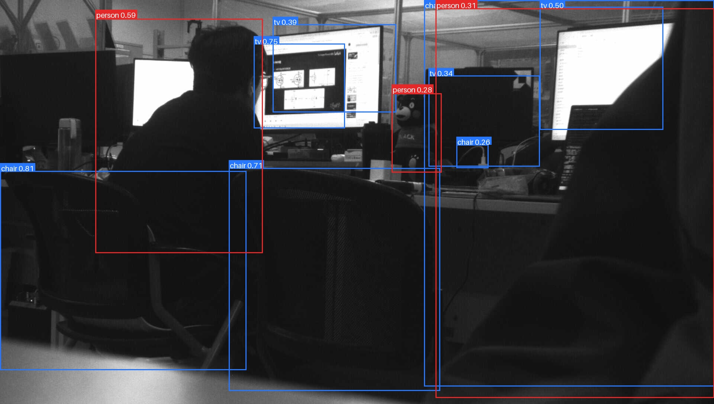

# 测试报告

只写**上板实测**；没有实测的标 `未测` 或 `推断`。架构见 [ARCHITECTURE](ARCHITECTURE.md)，
压缩见 [CODEC](CODEC.md)，赛题对照与缺口见 [REQUIREMENTS](REQUIREMENTS.md)。

## 1. 平台与配置

| 项 | 值 |
|---|---|
| FPGA | 安路 PH1P100SBG484，TD `Release_2026.2_NL` |
| 主机 / 相机 | Orange Pi 5 Max / RK3588（内核 7.2.0，NFS root）；2× IMX415，27 MHz / 891 Mbps ×4 lane |
| 互联 | PCIe Gen2 ×2（5 GT/s ×2，`LnkSta` 实测），BAR0 1 MiB |
| 位流 | ① 4K 采集；② 1920×1088 ROI/JPEG。两者独立，SRAM 配置 |
| 时钟 | clk_ddr 100 MHz（实测 99.92）、cam byte clk 187.5 MHz、tl_clk_user 62.5 MHz |

## 2. 六项交付状态

| # | 要求 | 状态 | 关键数据 | 证据 |
|---|---|---|---|---|
| 1 | MIPI CSI，≥1080p60，鼓励 4K30 | **4K30 达成；1080p60 未实现** | 3840×2160@29.9 fps，丢组 0；248 Mpix/s ≈2×1080p60 | §3 |
| 2 | ≥3 种预处理，AXI-Stream 流水线 | **达成（类 AXI-Stream）** | 灰度/高斯/HE，1920×1088@30 fps，端到端 41.9 ms | §4 |
| 3 | 硬件 JPEG，压缩率 ≥30% | **达成，非实时** | 94.7%~98.3%（典型 95.5%）；65.7 ms/帧，7.5~8.5 fps（亮场） | §5 |
| 4 | PCIe 传压缩帧，端到端 ≤50 ms | **传输段达成；端到端未闭合** | 压缩帧 93 KB <1 ms；4K RAW ≈20 ms；SOF→主机 ≈118 ms | §6 |
| 5 | RKNN 推理 + 回显/叠加 | **达成** | YOLO11n INT8 40~45 ms/帧；全链路 464~486 ms/帧 | §7 |
| 6 | 完整量化报告 | **五项有数，功耗未测** | 帧率/延迟/资源/压缩率/推理耗时 | §8 |

口径：2/3/5 证据完整；1 用 4K30 覆盖 1080p60 的像素吞吐但无 60 fps 时序；4 的 ≤50 ms 只在传输段成立；6 缺整机功耗。

## 3. 采集（交付项 1）

4K 采集位流，2026-10-29 实测：

| 项 | A 路 |
|---|---:|
| 分辨率 | 3840×2160 packed RAW10，stride 4,800 B |
| 几何 | 全阵列 3,864×2,192；有效图 3,840×2,160，`X_OFF=12`、`SKIP_ROWS=16`，原点 (12,16) |
| 每帧组数 `0x1A0` | 2,073,600（=2160×960，与理论值一致） |
| 丢组 `0x1A4` | **0** |
| AXI 拍数 `0xF0` | 324,096（=10,371,072 B / 32 B） |
| 帧率 | **29.9 fps** |
| R10F CRC | payload / header 双层逐字节复算通过 |

1080p ROI 通路（位流②）为 1920×1088@30 fps（§4）；**没有 1080p60 传感器模式**，4K30 像素吞吐虽是 1080p60 的 2 倍，60 fps 帧时序未验证，不写成“已满足 1080p60”。

### 运行时曝光（2026-10-30 新增）

传感器模拟增益由 BAR0 `0x280` 写入（码值，约 0.3 dB/LSB），`0x284` 回读
`{done_b, done_a, ae_st, applied_gain}`。链路是 BAR 写 → FPGA AE 状态机 →
I2C 0x3090，不需要重下位流。同场景实测（1920×1088，各取一帧）：

| 增益码 | dB | 均值 | 最大 |
|---:|---:|---:|---:|
| 0x00 | 0 | 12.6 | 26 |
| 0x40 | 19.2 | 19.1 | 138 |
| 0x64 | 30.0 | 37.0 | 255（饱和） |

单调且跨档明显，说明写入真正落到传感器；夜间建议 0x50~0x64，白天 0x10~0x20。

## 4. 预处理（交付项 2）

| 项 | 值 |
|---|---|
| ROI / 帧长 | 1920×1088（原点 972,552）；2,613,248 B/帧 |
| 帧率 / 延迟 | 30 fps；端到端 41.9 ms（SOF→主机） |
| 接口 | `valid/ready + SOF/EOL/EOF`，类 AXI-Stream；不是标准 AXI4-Stream（无 tlast/tuser） |
| 适配器 | `0x244` 收下 1,258 帧，`0x248/0x24C` 拒绝/溢出均为 0 |

三种算法切换 `0x240[2:1]`，各取一帧；复跑 `/root/pci_bar 0 0x240 0x2`（灰度）/ `0x4`（高斯）/ `0x6`（HE）后再 `frame_grab`：

| 模式 | 均值 | 标准差 | 拉普拉斯均值（高频能量） |
|---|---:|---:|---:|
| 0 灰度 | 29.6 | 44.2 | 6.04 |
| 1 高斯 | 29.7 | 43.7 | **1.30**（降 78%） |
| 2 直方图均衡 | **142.2** | 65.9 | 33.9 |

## 5. 硬件 JPEG（交付项 3）

1920×1088、q=50 亮度表；FPGA 只出熵编码码流，主机补 JFIF 头。编码器输入是解包后的
8 bit 灰度 2,088,960 B（R10F 线上为 packed RAW10 2,611,200 B），压缩率按前者计。

| 项 | 结果 |
|---|---:|
| 典型熵流 / 压缩率 | 93,443 B / **95.53%**（22.4×） |
| 长稳范围 | 35.8~110.8 KB，94.7%~98.3% |
| 编码器 | **65.7 ms/帧**（6.57 M 周期 @100 MHz），首字节 0.36 ms |
| 吞吐（亮场） | **7.5~8.5 fps**；1 h 长稳 26,965 帧 = 7.49 fps（历史记录），`jb_done` 严格单调 |
| 吞吐（暗场） | **4.07 fps**（60 s/28 帧，非单调 0，码流 88.4~88.9 KB） |
| PSNR | 整帧 34.9 dB；静态区域 34~40 dB |

主机参考编码器同帧对比（亮度均值 90.7；硬件固定 q=50，同场景 108,190 B vs 参考 105,130 B，差约 3%）：

| 指标 | q20 | q30 | q50 | q70 | q90 |
|--:|--:|--:|--:|--:|--:|
| 熵流字节 | 55,138 | 70,874 | 105,130 | 163,348 | 349,666 |
| 压缩率 | 97.36% | 96.61% | 94.97% | 92.18% | 83.26% |
| PSNR | 34.5 dB | 35.6 dB | 37.1 dB | 39.2 dB | 44.5 dB |

低光时传感器曝光变长，帧率降到 ~4 fps，编码器本身仍是 65.7 ms/帧；码流长度随场景变化，故用定长帧 + `0x250` 截取。

## 6. PCIe 与延迟（交付项 4）

| 口径 | 结果 |
|---|---|
| 4K RAW 整帧 10,371,072 B | 81,024 笔 128 B MWr；打包+DDR+PCIe ≈20 ms ⇒ **519 MB/s** |
| 压缩帧 ≈93 KB | PCIe 传输 **<1 ms**；主机取流 2.4 ms |
| 双路 1080p 自由采集 | 155.6 MB/s，占 Gen2 ×2 约 15.6% |

4K RAW，SOF→主机拿到帧：

$$
T_{\mathrm{E2E}} = 52.6 \sim 55.2\ \mathrm{ms}
= \underbrace{32.4\ \mathrm{ms}}_{\text{2192 行} \times 14.8\,\mu\mathrm{s}}
+ \underbrace{\approx 20\ \mathrm{ms}}_{\text{打包+DDR+PCIe}}
$$

压缩支路（2026-10-30 复测，3 帧平均）：

| 阶段 | 耗时 |
|---|---:|
| 等压缩完成（含等下一帧 + 65.7 ms 编码） | 182.5 ms |
| PCIe 取流 | 2.4 ms |
| JPEG 解码 | 13.9 ms（首帧 28.7，后两帧 6~7） |
| RKNN 推理 | 43.7 ms |
| **脚本墙钟合计** | **464~486 ms/帧** |

**口径**：≤50 ms 只在“PCIe 传输段”成立（压缩帧 <1 ms、4K RAW ≈20 ms）。SOF→主机拿到
压缩帧 ≈118 ms（传感器读出 + 65.7 ms 编码 + PCIe）；表里 182.5 ms 是 one-shot 脚本
“等压缩完成”的墙钟，含等下一帧，与 118 ms 不是同一时间基；TODO：用 EOF/门铃时间戳拉齐复核。
这是当前最大缺口，不把“传输段”写成“端到端”。

## 7. NPU（交付项 5）

| 项 | 结果 |
|---|---|
| 模型 | YOLO11n 640 INT8，双输出（boxes/scores 分开量化） |
| 推理 | **40~45 ms/帧**（双路实时，含反量化）；离线单帧 50.8 ms |
| 双路 960×544 | 21.9 pair/s，A 6 框 / B 7 框，错误 0 |
| 压缩流→NPU | 解码 6~28 ms + 推理 44 ms；暗场 1 个目标/帧，正常场景 4~10 个 |
| 叠加 | 归一化坐标画框，`--scale` 改尺寸不影响框位置 |

压缩流回传、解码后送 RKNN 的叠加结果（2026-10-30 板测，11 个目标）：

更多证据见 [evidence/detect.md](evidence/detect.md)；模型契约与部署见 [RKNN](RKNN.md)。

## 8. 资源、时序与功耗（交付项 6）

| 位流 | LUT6 | FF | ERAM | DSP | PLL | 时序 |
|---|---:|---:|---:|---:|---:|---|
| JPEG 位流（2026-10-30 20:22，含增益寄存器） | 27,964（39.01%） | 28,773（20.07%） | 160（53.33%） | 38（17.27%） | 3（25%） | Setup **+0.101 ns**，Hold +0.020 ns，0 违例 |
| 4K 采集位流（2026-10-29） | 17,548（24.5%） | — | 136 | 0 | — | SWNS +268 ps，HWNS +20 ps，0 FEP |

JPEG 位流另占 slice 30,940（43.16%）、DRAM-LUT 3,552、IO 107（37.41%）。

- 资源必须与本位流对应，两个位流不能混用一张表；本表是 TD 的 LUT6 计数，
  [build-status](../fpga/docs/build-status.md) 里的 slice 计数（31,217）口径不同，勿混用。
- **整机功耗：未测**。板上只有 thermal 与 pwmfan（7 路 hwmon 可读，板温 45.3~46.2 ℃），
  无 `power_supply`/INA226；需 USB-C PD 功率计或台式电源，分别测待机、4K 采集、JPEG 压缩、NPU 推理四态。

## 9. 稳定性

- 双路 1080p 自由采集 60.6 s：A/B 各 1,819 帧、29.997 fps、丢组 0；双路 pair 取帧 600/600 成功（180 s），A/B `capture_seq` 全相同。
- display 1080p 双路 2 分 25 秒 616 对，`a_seq == b_seq` 始终成立。
- 压缩长稳（1 h 26,965 帧、7.49 fps；暗场 60 s 4.07 fps）见 §5。

缺口与优先级见 [REQUIREMENTS](REQUIREMENTS.md) §5；复现步骤见 [README](../README.md)「快速开始」与
[driver/README](../driver/README.md)（位流 SRAM 下载后必须重启 RK3588 才能重新枚举 Gen2 ×2）。
