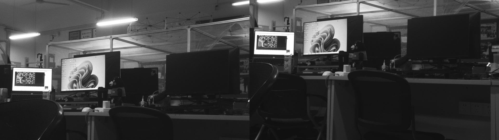

# 双路同步取帧板测（2026-10-28，1080p ROI）

同一次 `ARM_PAIR` 后，A/B 两片推帧引擎各取自己相机的下一帧，主机一次拿到槽 0/槽 1，再 `ACK_PAIR` 同时释放。

## 版本

- 位流 SHA256 `6777617e96f3ee89b3c8f6d626136c7f6d09ad6adfed8df64239a90bc4f79cf4`，Setup WNS +135 ps / Hold +20 ps，0 违例；
- 驱动 `anlogic_pci.ko`，`frame_slots=2`；工具 `frame_grab --pair`（aarch64 静态链接）。

## 一次典型结果

~~~text
门铃：A 1327->1328，B 1327->1328；sync pair_count 21957->21958
槽 0: R10F session=0xa1b2c3d4 seq=21948 1920x1080 stride=2400
槽 1: R10F session=0xa1b2c3d4 seq=21948 1920x1080 stride=2400
ACK：A seq=1328 B seq=1328；status A=0x1e B=0x1e
~~~

## 稳定性

- 连续 600 次双路取帧：600 成功 / 0 失败，180 s（≈3.3 pair/s，含进程启动与两帧 PGM 写盘）；
- 20 次逐帧核对：A/B R10F `capture_seq` 全部相同，门铃 A/B 同步 +1；
- 70 s 内 pair_count 持续增长，miss/overrun 均 0；单次进程墙钟 0.08~0.12 s。

## 图像

- `pair_contact.png`：A/B 左右并排；
- A.pgm SHA256 `983db528a0da66cac28fe68139cf5f5fd96ce9fc6b132ac28068ebad09983abd`；
- B.pgm SHA256 `94ea224357580087d7f98a837feecbea049a81493d03e1c6a5b74fce42e060fb`。

## 实时 display

`display-pair --source device-pair --fps 5 --port 8091` 连续跑 2 分 25 秒推 616 对，`/stats` 的 `a_seq` 与 `b_seq` 始终相同。
截图 `pair_display_a.jpg`（A，SHA256 `2b773446ba904a612388d65a4ef47f88f6e80de511ffe9c88bfd3928efa85f67`）。

## 帧率复测

| 口径 | 结果 |
|---|---|
| 源端 `0x1EC pair_count` | 5.03 s +151 → **30.0 pair/s**，miss/overrun=0 |
| 主机纯取帧（`--scale 8`） | **30.4 pair/s**，已到源端上限 |
| display 1920×1080 | ~90 ms/对 → **11 pair/s** |
| display 960×540（`--scale 2`） | ~43 ms/对 → **23 pair/s** |

1080p 分段耗时：去马赛克 26 ms、后处理 21 ms、RGB→NV12 13 ms、硬件 JPEG 21 ms（A/B 共用同一实例排队）。
优化路径：200 → 185 → 121 → 95 → 90 ms（流水线 + 两核并行编码 → 释放等待 20→5 ms → 算术去马赛克 → 高光去饱和并入查表）。

- 1080p 正式配置 `/root/display-pair --source device-pair --fps 30 --port 8091`：10 s 内 113 对，`a_seq == b_seq` 始终成立；
- MJPEG 实测 5 s 内 A 59 帧 / B 58 帧（约 11.6 fps/路）；
- 输出尺寸上报 1920×1088（VEPU121 把 1080 对齐到 1088）；该图未归档。

## 边界

- R10F 头没有 `sync_pairs` 字段；严格「同对」靠同步门控 + 同一次 ARM，一路丢帧后图像无法回溯所属 pair。
- PCIe 上 A/B 串行 MWr，不是同时占用链路。
- 两个 `/dev/video4` 实例并行编码实测 37 ms/对，比单实例串行 29 ms/对更慢，所以保持共用实例 + Mutex。